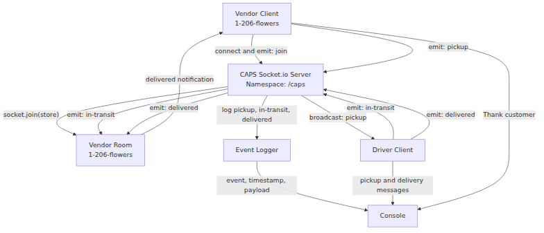

# CAPS — Code Academy Parcel Service

## Lab: Class 12 — Socket.io

CAPS is a simulated package delivery system built with Node.js and Socket.io.

This project demonstrates event-driven communication between independent vendor and driver clients through a central Socket.io server.

Class 12 extends the Class 11 EventEmitter application by introducing network-based events, Socket.io namespaces, and vendor-specific rooms.

## UML Diagram

[View CAPS Class 12 UML Diagram](./assets/uml.md)



## Application Structure

- `hub.js` — Creates the Socket.io server, manages the `/caps` namespace, and routes events.
- `index.js` — Starts the CAPS server on port `3000`.
- `vendor.js` — Connects as a vendor, joins its store room, creates orders, and handles delivery confirmations.
- `driver.js` — Connects as a driver, receives pickup requests, and emits delivery updates.
- `logger.js` — Logs events with timestamps and payloads.
- `__tests__/` — Contains Jest unit tests for the hub, vendor, driver, and logger.
- `assets/uml.md` — Documents the Socket.io event architecture.

## Socket.io Architecture

The CAPS server listens on port `3000` and uses the namespace:

`/caps`

Both the vendor and driver connect to:

`http://localhost:3000/caps`

The vendor joins a room identified by its store name:

`1-206-flowers`

The server uses this room to route delivery-related events to the appropriate vendor.

### Events

| Event | Sender | Server Behavior |
| --- | --- | --- |
| `join` | Vendor | Adds vendor to its store room |
| `pickup` | Vendor | Broadcasts to other connected clients |
| `in-transit` | Driver | Logs and routes to the vendor room |
| `delivered` | Driver | Logs and routes to the vendor room |

The vendor receives `delivered` and thanks the customer.

## Order Payload

Each order contains:

- `store` — Vendor name
- `orderId` — Unique order identifier
- `customer` — Customer name
- `address` — Delivery destination

Order IDs are generated using Node.js `randomUUID()`.

## Installation

Clone the repository and install dependencies:

```bash
git clone https://github.com/metswin17/caps.git
cd caps
npm install
```

## Run the Application

Open three separate terminals in the CAPS project directory.

### Terminal 1 — Start the CAPS Server

```bash
node index.js
```

Expected startup message:

`CAPS: Socket.io server running on port 3000`

### Terminal 2 — Start the Driver

```bash
node driver.js
```

The driver connects to the CAPS server and listens for pickup events.

### Terminal 3 — Start the Vendor

```bash
node vendor.js
```

The vendor connects to CAPS, joins the `1-206-flowers` room, and automatically generates a pickup request approximately every five seconds while connected.

The driver receives pickup requests and emits `in-transit` and `delivered` events.

The server logs each package event with a timestamp and payload.

The vendor receives delivery confirmations and displays:

`Thank you for your order Jane Doe`

Use `Ctrl+C` in each terminal to stop the processes.

## Run Tests

Run all Jest tests:

```bash
npm test
```

Run tests with coverage:

```bash
npm test -- --coverage
```

The test suite uses Jest mocks and spies to verify event handlers, Socket.io emissions, event routing, logging, and connection behavior without requiring live network connections.

### Verified Test Results

- 4 passing test suites
- 21 passing tests
- 86.76% overall statement coverage at the last complete coverage run (20 tests)

## Technologies

- JavaScript
- Node.js
- Socket.io
- Socket.io Client
- Jest
- Git and GitHub

## AI Assistance

ChatGPT was used as an interactive coding tutor during development of Classes 11 and 12.

For Class 12, assistance included:

- Planning the migration from Node.js EventEmitter to Socket.io.
- Explaining Socket.io namespaces, rooms, broadcasting, and event routing.
- Implementing and reviewing the server, vendor, and driver modules.
- Refactoring event handlers to make them independently testable.
- Developing Jest tests using mocked Socket.io clients, spies, and fake timers.
- Troubleshooting accidental file edits and checking application behavior.
- Explaining terminal commands and interpreting coverage reports.
- Updating the UML diagram and project documentation.

### AI Prompt Examples

The following are representative descriptions of requests made during development, not verbatim transcripts:

1. Help migrate the CAPS EventEmitter application to Socket.io.
2. Explain how the vendor joins a Socket.io room and receives delivery notifications.
3. Help test Socket.io event handlers without opening real network connections.
4. Show how Jest fake timers can test automatic vendor pickup requests.
5. Explain the Jest coverage report and identify important untested behavior.
6. Help update the Class 12 UML diagram and README.

All application changes were entered, executed, and tested locally during development.

