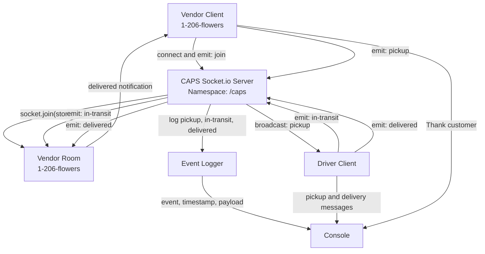

# CAPS — Class 12 UML Diagram

## Phase 2: Socket.io Event-Driven Architecture

## Event Payload

Each package event carries the following information:

- `store`: Name of the vendor
- `orderId`: Unique package identifier
- `customer`: Customer's name
- `address`: Delivery destination

## Event Sequence

1. The CAPS Socket.io server starts on port `3000` using the `/caps` namespace.
2. The driver and vendor connect as separate Socket.io clients.
3. The vendor emits `join` with its store name, `1-206-flowers`.
4. The server adds the vendor socket to the matching store room.
5. The vendor creates an order and emits `pickup`.
6. The server logs the event and broadcasts `pickup` to other connected clients.
7. The driver receives `pickup` and emits `in-transit`.
8. The server logs `in-transit` and forwards it to the vendor's room.
9. The driver emits `delivered`.
10. The server logs `delivered` and forwards it to the vendor's room.
11. The vendor receives `delivered` and thanks the customer.

## Architecture Notes

- **Socket.io server:** `hub.js`
- **Server entry point:** `index.js`
- **Vendor client:** `vendor.js`
- **Driver client:** `driver.js`
- **Event logger:** `logger.js`
- **Namespace:** `/caps`
- **Vendor room:** `1-206-flowers`

The server broadcasts pickup events to other clients, excluding the sender. Delivery-related events are routed to the appropriate vendor room.

