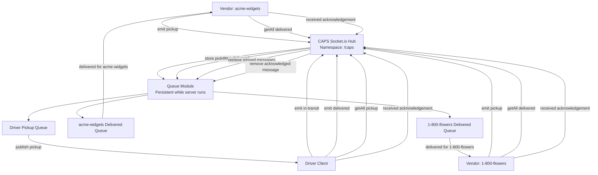

# CAPS — Class 13 UML Diagram

## Phase 3: Socket.io Message Queues



## Message Payload

Queued messages will use the following structure:

```js
{
  event: 'pickup',
  messageId: 'unique-order-id',
  clientId: 'drivers',
  order: {
    store: 'acme-widgets',
    orderId: 'unique-order-id',
    customer: 'Jane Doe',
    address: 'Portland, OR'
  }
}
```

For delivered notifications, `event` becomes `delivered` and `clientId` identifies the appropriate store.

## Queue Events

| Event | Purpose |
| --- | --- |
| `pickup` | Store an order for drivers to collect |
| `in-transit` | Notify CAPS that a driver is transporting an order |
| `delivered` | Store a delivery notification for the correct vendor |
| `getAll` | Retrieve messages missed while disconnected |
| `received` | Acknowledge a message so it can be removed |

## Event Sequence

1. Start the CAPS Socket.io server on port `3000`.
2. Connect the driver and both vendor clients to `/caps`.
3. Vendors publish pickup requests.
4. CAPS stores pickup messages in the driver queue.
5. Drivers receive pickup notifications and acknowledge them.
6. Drivers emit `in-transit` and `delivered`.
7. CAPS stores delivery notifications in the appropriate vendor queue.
8. Vendors receive delivery notifications and acknowledge them.
9. When a client reconnects, it emits `getAll` for missed messages.
10. CAPS replays unacknowledged messages.
11. The server removes messages only after receiving the correct acknowledgement.

## Architecture Notes

- `hub.js` — Socket.io server and event routing
- `queue.js` — In-memory message queue module (planned)
- `driver.js` — Driver subscriber and acknowledgement logic
- `vendor.js` — Vendor subscribers for both stores
- `logger.js` — Timestamped event logging
- `index.js` — Server entry point

The queue will retain messages during client disconnections. Because this first implementation uses in-memory storage, messages will not survive a restart of the CAPS server itself.
