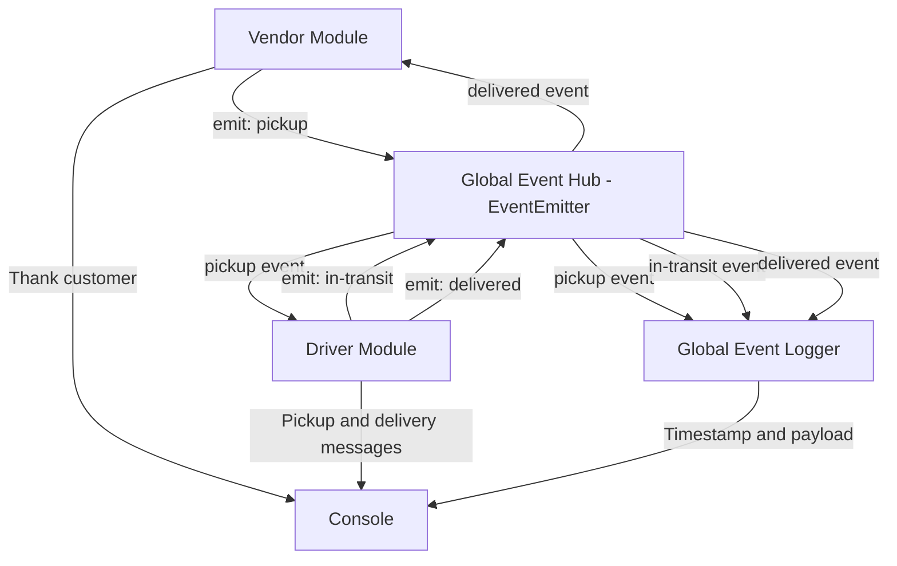

# CAPS — Class 11 UML Diagram

## Phase 1: Event-Driven Architecture

## Event Payload

Each package event carries the following information:

- `store`: Name of the vendor
- `orderId`: Unique package identifier
- `customer`: Customer's name
- `address`: Delivery destination

## Event Sequence

1. Vendor emits `pickup`.
2. Driver listens for `pickup` and confirms pickup.
3. Driver emits `in-transit`.
4. Driver confirms delivery and emits `delivered`.
5. Vendor listens for `delivered` and thanks the customer.
6. Global Event Logger records the events with timestamps and payloads.

